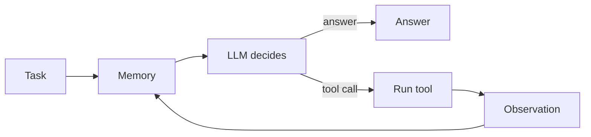

<div align="center">

# 🤖 TinyAgent

### Build an AI agent from scratch in Python: a minimal, readable LLM agent framework you can learn from line by line.

**Tool calling · function calling · agent memory · RAG · ReAct · local LLMs with llama.cpp · Docker**

[](https://www.python.org/) [](LICENSE) [](pyproject.toml) [](INSTRUCTIONS.md) [-black)](deploy/README.md) [](docs/)

[What is it](#-what-is-tinyagent) · [Features](#-features) · [Quickstart](#-quickstart) · [How it works](#-how-an-llm-agent-works) · [Learn](#-what-you-will-learn) · [Roadmap](#%EF%B8%8F-roadmap) · [FAQ](#-faq)

</div>

---

## ✨ What is TinyAgent?

An LLM only turns text into text. **The harness**, the code around the model, is what turns it into an **AI agent**: it keeps the conversation, decides what to send, runs tools and feeds the results back. TinyAgent is that harness, written small enough to read in an afternoon and split so each capability (LLM, memory, tools, planning) plugs in as its own component.

It is an **educational agent framework**: no hidden magic, no heavy dependencies (four runtime packages), every file documented for someone meeting agents for the first time, and every concept backed by tests. It runs against **local open models** (Qwen, Gemma) served by llama.cpp in Docker, so you need no API key and no cloud account.

> **Status:** the harness calls the model, keeps memory, runs tools (prompted JSON or native function calling) with optional human approval, and records every step. The multi-step **ReAct loop and planner are in progress**. See the [roadmap](#%EF%B8%8F-roadmap).

## 🚀 Features

| | Feature | What you get |
|---|---|---|
| 🧠 | **LLM client** | One small client for any OpenAI-compatible server (llama.cpp, hosted APIs): chat, thinking/reasoning output, embeddings, a model check |
| 📚 | **Agent memory** | Five interchangeable memories: full history, a sliding window (`TrimmingMemory`), a running summary (`SummarizationMemory`), retrieval-augmented memory (`RAGMemory`) and long-term memory with forgetting (`MemoryBank`) |
| 🛠️ | **Tool calling** | Two ways to give an LLM tools: **prompted** tools (definitions in the system prompt, JSON in the reply) and **native function calling** (JSON schemas built from Python type hints and docstrings) |
| ✋ | **Human in the loop** | Per-tool approval (`Allow multiply? [y/N]`) before anything runs |
| 🏁 | **Stopping** | A reply without a tool call, or a `final_answer` call, ends the run |
| 🧾 | **Trajectory** | A step-by-step record (thought, action, observation, answer) for debugging |
| 💬 | **Terminal chat** | `tiny-agent` command for an interactive chat or one-shot questions |
| 🐳 | **Local LLM stack** | Docker: llama.cpp (GPU, CPU fallback), a web chat app, an nginx gateway and log search with OpenObserve |
| 📖 | **Book scripts** | Runnable, documented scripts for prompting, best-of-N, reward models, embeddings, memory and ReAct |
| ✅ | **Tests** | pytest against fake model servers, live tests against real models, Playwright for the web UI |

## ⚡ Quickstart

```powershell
git clone https://github.com/tiny-vault/tiny-agent-design.git
cd tiny-agent-design
python -m venv .venv
.\.venv\Scripts\Activate.ps1
python -m pip install -e .

node execute.mjs up llm-client                 # start a local model server (Docker, port 3200)
node execute.mjs llm-client load qwen3.5-4b    # first load downloads the model from Hugging Face
tiny-agent "What is an AI agent?"              # ask once, or run `tiny-agent` for a chat
```

The first model load downloads from Hugging Face (minutes); after that, loading takes about 35 seconds. Everything else (the web chat app, tests, logs, docs) is in [INSTRUCTIONS.md](INSTRUCTIONS.md).

### Use it from Python

```python
from tiny_agent.agent import TinyAgent
from tiny_agent.components.client.llm import LLM
from tiny_agent.components.memory.memory import Memory
from tiny_agent.components.tools.default import default_native_tools

llm = LLM(model="qwen3.5-4b")                              # any OpenAI-compatible server
agent = TinyAgent(llm, Memory(), default_native_tools())   # memory + native function calling

print(agent.run("Use the multiply tool to compute 6 times 7."))  # OBSERVATION: 42.0
print(agent.run("So what is the answer?"))                        # the model reads the observation from memory
```

## 🧩 How an LLM agent works



| Component | Role | In TinyAgent |
|---|---|---|
| 🧠 `llm` | The brain: reasons and picks the next step | `components/client/llm.py` |
| 📚 `memory` | The context: past messages and observations | `components/memory/` |
| 🛠️ `tools` | The hands: functions that act on the world | `components/tools/` |
| 🗺️ `planner` | The strategy: splits a goal into steps (ReAct) | in progress |
| 🧾 `trajectory` | The logbook: what happened, step by step | `components/trajectory.py` |

| Method | Phase | Job |
|---|---|---|
| `run(task)` | Entry point | Store the task, start a trajectory, take a step |
| `_step()` | Think | Send memory (and tool schemas) to the LLM, store the reply, parse a tool call |
| `_execute_action()` | Act and observe | Run the tool, store the observation, record the step |

## 🎓 What you will learn

- **What makes an LLM an agent**: the harness, the agent loop, and why the model itself is stateless.
- **Agent memory**: context windows, trimming, summarization, RAG with embeddings and cosine similarity, and long-term memory with a forgetting curve (MemoryBank).
- **Tool use and function calling**: writing tool definitions an LLM can use, JSON schemas from type hints, parsing tool calls, `tool` messages, human approval and stopping with `final_answer`.
- **Reasoning and test-time compute**: zero-, one- and few-shot prompting, chain-of-thought, best-of-N with outcome and process reward models, majority voting.
- **Running open models locally**: llama.cpp router mode, model switching on a 6 GB GPU, Docker secrets and log search.

## 🗂️ Project layout

```
tiny-agent-design/
├── tiny_agent/                 # the TinyAgent package
│   ├── agent.py                #   the harness: run, _step, _execute_action
│   ├── components/
│   │   ├── client/             #   LLM and embedding client, model check
│   │   ├── memory/             #   Memory, TrimmingMemory, SummarizationMemory, RAGMemory, MemoryBank
│   │   ├── tools/              #   PromptingTools, LearnedTools, tool functions
│   │   ├── trajectory.py       #   the step-by-step record
│   │   └── step.py
│   ├── config/                 #   settings from tiny_agent/.env
│   ├── complete/               #   end-to-end runs against a real model
│   ├── cli.py, main.py         #   the tiny-agent command and the demo
│   └── tests/                  #   pytest suite
├── deploy/                     # Docker: chat-app, llm-client, tiny-agent, docs (independent parts)
├── experimentation/
│   ├── chat-app/               # web chat UI (React, FastAPI) for local models
│   └── illustrated_agents/     # runnable scripts from the book, one per concept
├── docs/                       # Sphinx documentation
└── execute.mjs                 # one entry point: start, stop, test, logs
```

<details>
<summary><b>⚙️ Settings (<code>tiny_agent/.env</code>)</b></summary>

The Python code reads its settings from `tiny_agent/.env` (git-ignored; `tiny_agent/.env.example` is the template). A value set in your shell or given as an option always wins over the file.

| Setting | What it does |
|---|---|
| `TINYAGENT_MODEL` | The model to chat with (default: whichever is loaded) |
| `TINYAGENT_LLM_URL` | The server address (default: the Docker gateway) |
| `TINYAGENT_SYSTEM`, `TINYAGENT_THINK` | A system message; let the model think |
| `TINYAGENT_TOOLS`, `TINYAGENT_NATIVE_TOOLS` | Give the demo prompted tools or native function calling (native wins) |
| `TINYAGENT_TRIM_MEMORY` | Keep only the last two turns |
| `TINYAGENT_SUMMARY_MEMORY` | Keep a model-written running summary (one extra model call per turn) |
| `TINYAGENT_RAG_MEMORY`, `TINYAGENT_EMBEDDING_MODEL` | Put the three most similar documents in front of each question (needs an embedding model loaded too) |
| `TINYAGENT_BANK_MEMORY` | MemoryBank: per-turn summaries and a user portrait that fade unless recalled |
| `TINYAGENT_API_KEY_FILE` or `TINYAGENT_API_KEY` | A key for a hosted server (the Docker stack needs none) |
| `TINYAGENT_LOG_DIR`, `TINYAGENT_LOG_LEVEL` | Where and how much `cli.log` and `main.log` log |

Memory flag priority: bank > RAG > summary > trim.

</details>

<details>
<summary><b>📊 Measured on a 6 GB laptop GPU</b></summary>

Measured on an RTX 3060 Laptop GPU (6 GB) with the two local models.

| What | Result |
|---|---|
| Switching to `qwen3.5-4b` (2.7 GB), model on disk | 35 s |
| Switching to `gemma4-e4b` (5.2 GB), model on disk | 61 to 69 s |
| First load, including the Hugging Face download | 6 min (`qwen3.5-4b`), 15 to 20 min (`gemma4-e4b`) |
| Answer starts, model already loaded | about 1 s |

Only one model fits in GPU memory at a time, so every switch is a full reload.

</details>

## 📖 Documentation

Full docs (architecture, API reference, the chat app, the book scripts) are built with Sphinx and Furo. `node execute.mjs docs` serves them at <http://localhost:3300>; to build them yourself:

```powershell
pip install -r docs/requirements.txt
python -m sphinx -b html -n -W --keep-going docs docs/_build/html
```

## 🛣️ Roadmap

- [x] LLM client, model check and terminal chat
- [x] Docker stack: llama.cpp with Hugging Face models, web chat app, logs, secrets
- [x] Step 1: LLM integration (one model call per task)
- [x] Step 2: Memory (full, trimming, summarization, RAG, MemoryBank)
- [x] Step 3: Tools (prompted and native function calling, approval, `final_answer`)
- [ ] Step 4: Planning with ReAct and the multi-step agent loop (in progress)
- [ ] Reflection

## ❓ FAQ

**How do I build an AI agent from scratch in Python?** Start with a model client, add a memory that resends the conversation, then a tool registry and a parser for tool calls, then a loop. TinyAgent is exactly that, one step per component, with tests for each.

**Does it need OpenAI or an API key?** No. It runs local open models through llama.cpp in Docker. Any OpenAI-compatible server works too; set `TINYAGENT_LLM_URL` and a key.

**What is the difference between prompted tools and native function calling?** Prompted tools describe functions in the system prompt and read JSON from the reply text, which works with any model. Native function calling sends JSON schemas in the request and reads a structured `tool_calls` field, which needs a model trained for it. TinyAgent implements both behind the same interface.

**Is this a production framework like LangChain or LlamaIndex?** No. It is built to be read and understood. Use it to learn how agents work, then pick a production framework knowing what it does for you.

**What hardware do I need?** A GPU with 6 GB runs the 4B model; there is a slower CPU fallback.

## 🤝 Contributing

Issues and pull requests are welcome. Run `node execute.mjs test` before opening a PR, and see [AGENTS.md](AGENTS.md) for the conventions.

---

<div align="center">

**If TinyAgent helped you understand AI agents, please ⭐ star the repo so others can find it.**

Based on *An Illustrated Guide to AI Agents* by Maarten Grootendorst and Jay Alammar (O'Reilly). Companion code: [HandsOnLLM/An-Illustrated-Guide-To-AI-Agents](https://github.com/HandsOnLLM/An-Illustrated-Guide-To-AI-Agents). That repository has no license, so all rights remain with the authors. This is a personal learning project, not affiliated with or endorsed by them. If you find the book useful, please cite it.

The chat UI's look is adapted from [Utopia](https://github.com/deeplethe/utopia) by DeepLethe (Apache-2.0). This repository is licensed under [Apache-2.0](LICENSE).

</div>
